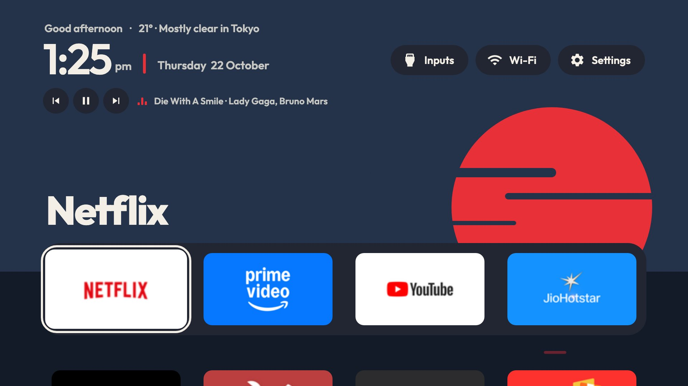
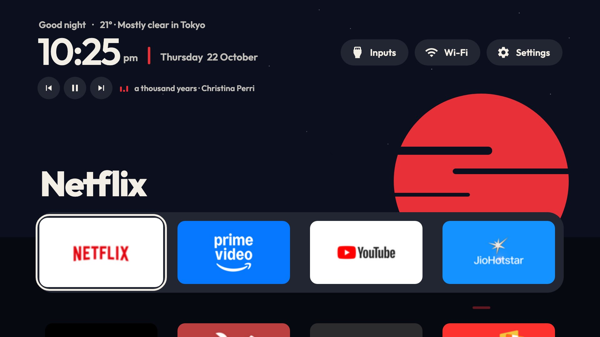

# webOS Custom Anime Theme with Music Player

An anime-style home screen for LG webOS TVs: a flat dusk scene with a big sun on the horizon, live
weather, a sky that follows the time of day, and a background music player.

Built on [webos-vibehack](https://github.com/OmkarK97/webos-vibehack), the webOS port of
[tv-vibehack](https://github.com/Gathin23/tv-vibehack)'s Apple TV-style launcher.

| Day | Night |
|---|---|
|  |  |

Tested on an LG LM636 and an LG OLED C6 (webOS 26). The original launcher, before the anime theme:
[docs/screenshot.jpg](docs/screenshot.jpg).

## Features

**Anime dusk scene**
- Flat, anime-style sky over water, with the dock as the horizon.
- The sky and water colours follow the real time through dawn, day, dusk and night, and stars
  twinkle at night.
- The sun takes the colour of the focused app, and its reflection shimmers on the water.
- Clouds drift across the sun, and the sun sets below the horizon when you scroll into the app grid.

**Live weather**
- The temperature and conditions show after the greeting, for example "24° · Clear in Tokyo".
  The data comes from [Open-Meteo](https://open-meteo.com), which is free and needs no key.
- The weather shows in the scene: overcast adds more clouds, and rain or snow
  falls across the screen.
- The city is detected from your network, or you can set `weatherCity` in `app/config.js`.

**Your own character**
- Put your character's pictures in `app/characters/`: `morning.png`, `day.png`, `evening.png` and
  `night.png`. Transparent PNGs look best.
- The picture stands on the horizon, bobs gently, and crossfades when the time of day changes.
  Any missing picture is skipped.

**Background music**
- A calm playlist streams from JioSaavn quietly while the launcher is open.
- The music fades out when an app opens and fades back in when you return.
- The remote's media keys work too: ▶ ⏸ to play and pause, ⏩ ⏪ to skip.
- To change the songs, edit the list at the top of `app/music.js`, or put MP3s in `app/music/` and
  list them there (`src: 'music/song.mp3'`).
- Or play a public Spotify playlist: `sync-playlist.py` looks up each song on your own
  [JioSaavnAPI](https://github.com/cyberboysumanjay/JioSaavnAPI) and writes `app/playlist.js`:
  ```bash
  # in the JioSaavnAPI folder, in its own terminal
  pip3 install -r requirements.txt && python3 app.py
  # here
  python3 sync-playlist.py https://open.spotify.com/playlist/<id>
  TV_HOST=192.168.1.50 ./install.sh
  ```
- Under the clock: previous, play/pause and next buttons, and the song that's playing.

**Animations**
- On startup the sun rises and the header drops in.
- Manga speed lines streak past when the focused app changes.
- Opening an app plays a full-screen wipe in its colour with its name.
- The focus frame springs between tiles, and the buttons respond with a small bounce.

**TV-friendly**
- Large, bold type that reads from across the room.
- A thick, solid focus frame that's easy to follow.
- The CSS works on older webOS browsers (2020 models onwards).

**Launcher basics**
- A dock with your four favourite apps, plus a grid of all your apps synced from the TV.
- An Inputs menu (HDMI and Live TV), Wi-Fi and Settings.
- Rearrange tiles on the TV, and send the Home button to the launcher with `home-watch.py`.

## What's different from Android

webOS is more locked down than Android TV, so three things work differently:

| | Android TV | LG webOS |
|---|---|---|
| Install | ADB, no account | LG's **Developer Mode** app (free LG developer account) |
| App list | read on the TV | read from your computer by `sync-apps.py` and bundled in; webOS won't let an app list installed apps |
| Home button | the launcher *is* Home | webOS always opens LG's home; `home-watch.py`, running on another device, switches straight back (about 0.1 s) |

There's no debloat step: webOS has no ADB-style package disabling. Turn off LG's ads in the TV's
own settings instead (see [Cleaning up LG's home](#cleaning-up-lgs-home)).

Nothing is rooted. Developer Mode is LG's official way to install your own apps, firmware updates
keep working, and deleting the Developer Mode app removes everything.

## Setup

You need a Mac on the same Wi-Fi as the TV, with Node.js (for LG's `ares` CLI, fetched with `npx`)
and Python 3. The steps are macOS only for now: `install.sh` makes the app icon with `sips`.

**1. Developer Mode on the TV**

1. Create a free account at [webostv.developer.lge.com](https://webostv.developer.lge.com).
2. On the TV, install **Developer Mode** from the LG Content Store and sign in.
3. Turn on **Dev Mode Status** (the TV restarts), open the app again and turn on **Key Server**.
   Note the **IP address** and **Passphrase** it shows.

**2. Connect your computer** (once)

```bash
export TV_HOST=192.168.1.50                       # the IP from the Developer Mode app
npx -y -p @webos-tools/cli ares-setup-device -a lgtv -i "{'host':'$TV_HOST','port':'9922','username':'prisoner'}"
npx -y -p @webos-tools/cli ares-novacom --device lgtv --getkey        # type the passphrase
npx -y -p @webos-tools/cli ares-setup-device -m lgtv -i "{'privatekey':'lgtv_webos','passphrase':'ABC123'}"
```

**3. Install**

```bash
git clone https://github.com/Laksh-Devloper/Web-OS-Custom-Anime-Theme-with-Music-Player.git
cd Web-OS-Custom-Anime-Theme-with-Music-Player
python3 -m venv venv && venv/bin/pip install websockets
TV_HOST=192.168.1.50 ./install.sh
```

The first run shows an "allow this device?" prompt on the TV: accept it. That pairing lets
`sync-apps.py` read your apps and icons. `install.sh` then packages the app, installs it and opens
it. Run it again whenever you install or remove apps on the TV.

**4. A one-press shortcut**

With the launcher open, hold a number key on the remote (say **1**) and assign it. From then on,
holding 1 opens the launcher from anywhere.

## The Home button

webOS hard-wires Home to LG's home, and blocks Developer Mode apps from seeing which app is in front,
so the TV can't redirect it on its own. [`home-watch.py`](home-watch.py) does it from another
always-on device on the same network: it watches the TV's foreground app and, the moment LG's home
appears, opens the launcher on top.

- **Press Home twice** within three seconds to stay on LG's home, for its menus.
- When the TV powers on to LG's home, it goes to the launcher too.
- When the watcher isn't running, Home simply opens LG's home as usual.

On a Mac, install it as a background service that starts at login:

```bash
TV_HOST=192.168.1.50 ./home-watch-mac.sh       # install or update
./home-watch-mac.sh uninstall                  # remove
```

macOS will ask for Local Network access for Python: allow it (System Settings → Privacy & Security →
Local Network), or the watcher logs "No route to host". The log is at
`~/Library/Logs/tv-vibehack-home-watch.log`. A Mac only redirects Home while it's awake and at
home; for every time, run `python3 home-watch.py 192.168.1.50` on something that's always on, such
as a Raspberry Pi.

## Using it

Same as the [Android launcher](https://github.com/Gathin23/tv-vibehack#the-launcher): a dock of four apps with the focused app's name above it and a glow
in its colour, the rest of your apps in a grid below, and Inputs (HDMI ports and Live TV), Wi-Fi
and Settings at the top. The header slides away when the grid scrolls into it.

**Rearrange tiles on the TV**: hold **OK** on a tile until it wiggles, move it with the arrows
(into the top row puts it in the dock), then **OK** to place it or **Back** to cancel. The order is
saved on the TV.

**Configure** in [`app/config.js`](app/config.js): the starting dock, apps to hide, the Live TV
app and the number of columns. App ids come from `venv/bin/python sync-apps.py $TV_HOST --list`.
Changing `dockApps` resets an order arranged on the TV.

## Cleaning up LG's home

For when you do land on it. Names vary a little by webOS version:

- **Settings → General → System → Additional Settings → Home Settings**: turn off **Home
  Promotion** and **Content Recommendation**.
- **Settings → Support → Privacy & Terms → User Agreements**: untick **Viewing Information** and
  **Interest-Based Recommendations**.

## Troubleshooting

- **Pairing fails with "403 Pairing rejected: blacklisted certificate detected".** Newer firmware
  rejects the signed manifest that open-source LG clients share. `lgtv.py` pairs with an unsigned
  one, which still works.
- **No pairing prompt on the TV.** Turn on the TV's option for connecting from mobile apps (on the
  C6: Settings → General → Devices → External Devices; named "LG Connect Apps" or similar).
- **`ares` says "All configured authentication methods failed".** The device profile is missing
  its key: run the third command in step 2 again.
- **Apps stop opening after a while.** Developer Mode sessions expire (LG shows the time left in
  the Developer Mode app; it was 999 hours on our C6). Press **Extend Session Time** there.

## Files

| File | What it does |
|---|---|
| [`app/`](app/) | The launcher: `index.html`, `style.css`, `app.js`, `config.js`, `appinfo.json` |
| [`app/scene.js`](app/scene.js) | Time-of-day sky colours and stars, live weather, the character |
| [`app/music.js`](app/music.js) | Background music player and playlist |
| [`app/characters/`](app/characters/) | Your character images, one per time of day |
| [`sync-playlist.py`](sync-playlist.py) | Turns a public Spotify playlist into `app/playlist.js` via your JioSaavnAPI |
| [`install.sh`](install.sh) | Syncs your apps, packages and installs the launcher, and opens it |
| [`sync-apps.py`](sync-apps.py) | Reads apps, icons and HDMI inputs from the TV into `app/apps.js` and `app/icons/` |
| [`home-watch.py`](home-watch.py) | Sends the Home button to the launcher |
| [`home-watch-mac.sh`](home-watch-mac.sh) | Runs the watcher as a macOS background service |
| [`lgtv.py`](lgtv.py) | Pairs with and talks to the TV's remote-control service |
| [`assets/icon.jpg`](assets/icon.jpg) | The app icon, resized to PNG by `install.sh` |

## References

Projects and services this one is built on or uses:

| Reference | What we took from it |
|---|---|
| [OmkarK97/webos-vibehack](https://github.com/OmkarK97/webos-vibehack) | The webOS launcher this repo is built on: app grid, dock, Inputs menu, remote navigation, `install.sh`, `sync-apps.py`, `home-watch.py`, `lgtv.py` |
| [Gathin23/tv-vibehack](https://github.com/Gathin23/tv-vibehack) | The original Apple TV-style launcher for Android TV: design, layout and app icon |
| [cyberboysumanjay/JioSaavnAPI](https://github.com/cyberboysumanjay/JioSaavnAPI) | Song lookups for `sync-playlist.py`, and the approach used to resolve the JioSaavn stream links |
| [Open-Meteo](https://open-meteo.com) | Live weather and city geocoding (free, no key) |
| [ipwho.is](https://ipwho.is) | Detecting the city from the network when `weatherCity` is empty |
| [Spotify embed player](https://open.spotify.com) | Reading the track list of a public playlist in `sync-playlist.py` |
| [webOS TV CLI (`@webos-tools/cli`)](https://github.com/webos-tools/cli) | Packaging and installing the app (`ares-package`, `ares-install`) |
| [Outfit](https://github.com/Outfitio/Outfit-Fonts) | The typeface, under the SIL Open Font License |

## Credits

The anime theme, live weather, time-of-day sky and music player are by
[Laksh-Devloper](https://github.com/Laksh-Devloper). The launcher itself is
[webos-vibehack](https://github.com/OmkarK97/webos-vibehack). The design, layout and app icon come from [tv-vibehack](https://github.com/Gathin23/tv-vibehack)
by [Gathin](https://github.com/Gathin23). The Outfit font is under the SIL Open Font License
([`app/fonts/OFL.txt`](app/fonts/OFL.txt)). MIT licensed, see [`LICENSE`](LICENSE).
